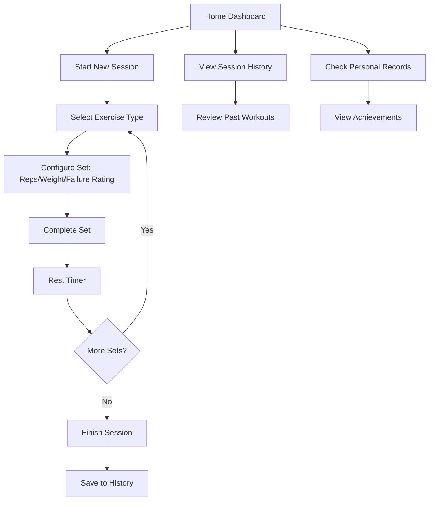

## 1. Product Overview
A minimalistic yet elegant Progressive Web App (PWA) for tracking pull-up workouts with detailed session management, exercise variations, and progress analytics. Designed for fitness enthusiasts who want to monitor their pull-up performance with precision and track their progress over time.

The app solves the problem of manually counting and tracking pull-up workouts by providing an intuitive mobile-first interface with customizable rest timers, exercise variations, and comprehensive progress tracking. Target users are fitness enthusiasts, calisthenics practitioners, and anyone serious about improving their pull-up performance.

## 2. Core Features

### 2.1 User Roles
No role distinction needed - single user focused app for personal workout tracking.

### 2.2 Feature Module
Our pull-up counter app consists of the following main pages:
1. **Home Dashboard**: Today's session overview, quick start button, recent sessions summary
2. **Active Session**: Live workout interface with set counter, rest timer, exercise selection
3. **Session History**: Past workout records with detailed analytics and progress charts
4. **Personal Records**: Best achievements tracking for reps, weights, and resistance levels

### 2.3 Page Details
| Page Name | Module Name | Feature description |
|-----------|-------------|---------------------|
| Home Dashboard | Today's Overview | Display current day's session status with quick stats |
| Home Dashboard | Quick Start | One-tap button to start new pull-up session |
| Home Dashboard | Recent Sessions | Show last 3-5 workout sessions with key metrics |
| Active Session | Exercise Selection | Choose between pull-up variations (normal, neutral, chin-up) |
| Active Session | Set Configuration | Set reps count, add weight/resistance, rate proximity to failure |
| Active Session | Rest Timer | Automatic countdown between sets with customizable duration |
| Active Session | Session Controls | Start/pause session, complete set, finish workout |
| Session History | Calendar View | Monthly calendar showing workout frequency |
| Session History | Session Details | Expandable view of each session with all sets and metrics |
| Session History | Progress Charts | Visual graphs showing improvement over time |
| Personal Records | Max Reps | Display highest repetition count achieved |
| Personal Records | Max Weight | Show heaviest weighted pull-up performed |
| Personal Records | Max Resistance | Track highest resistance band level used |
| Personal Records | Achievement Timeline | Chronological list of personal bests |

## 3. Core Process
**Workout Flow**: User opens app → Views dashboard → Starts new session → Selects exercise type → Configures first set (reps, weight/resistance, failure rating) → Completes set → Rest timer starts → Timer finishes → Adds next set → Repeats until workout complete → Session saved to history

**Progress Review Flow**: User navigates to history → Views calendar → Selects specific session → Reviews detailed metrics → Compares with previous sessions → Checks personal records

## 4. User Interface Design

### 4.1 Design Style
- **Primary Colors**: Deep blue (#1a365d) for primary actions, clean white (#ffffff) for backgrounds
- **Secondary Colors**: Light gray (#f7fafc) for cards, success green (#38a169) for achievements
- **Button Style**: Rounded rectangles with subtle shadows, 3D press effect on tap
- **Typography**: Clean sans-serif (Inter or similar), 16px base size, clear hierarchy
- **Layout**: Card-based design with generous spacing, bottom navigation for mobile
- **Icons**: Minimal line icons with consistent stroke weight, fitness-themed symbols

### 4.2 Page Design Overview
| Page Name | Module Name | UI Elements |
|-----------|-------------|-------------|
| Home Dashboard | Today's Overview | Large stat cards with current day progress, circular progress indicators |
| Home Dashboard | Quick Start | Prominent floating action button with pull-up icon |
| Active Session | Exercise Selection | Horizontal pill buttons for exercise types, visual exercise illustrations |
| Active Session | Set Configuration | Large number input with +/- buttons, slider for failure rating |
| Active Session | Rest Timer | Large circular countdown with pause/skip controls |
| Session History | Calendar View | Monthly grid with workout days highlighted in green |
| Personal Records | Achievement Cards | Trophy icons with gold accents, large numbers for records |

### 4.3 Responsiveness
Mobile-first design with touch-optimized interactions. Single column layout for all screen sizes. Large touch targets (minimum 44px) for all interactive elements. Swipe gestures for navigation between sessions. Progressive Web App capabilities with offline functionality and home screen installation.

## 5. Technical Specifications
- Progressive Web App with offline capability
- Local data storage using IndexedDB
- Service worker for background functionality
- Responsive design for all mobile screen sizes
- Touch-optimized interactions and gestures
- Data export/import functionality for backup