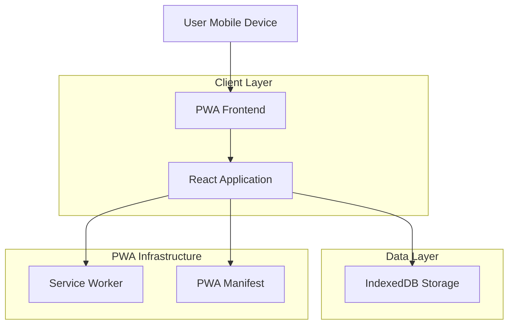
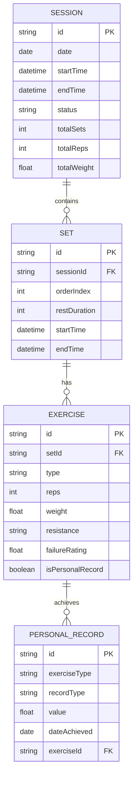
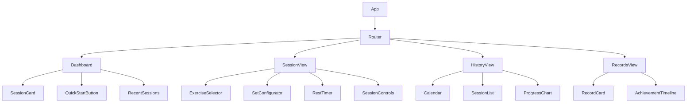

## 1. Architecture Design



## 2. Technology Description
- **Frontend**: React@18 + TypeScript + Vite
- **Styling**: TailwindCSS@3 + CSS Modules
- **State Management**: React Context + useReducer
- **Storage**: IndexedDB via Dexie.js
- **PWA**: Vite PWA Plugin with Workbox
- **Testing**: Jest + React Testing Library
- **Initialization Tool**: vite-init

## 3. Route Definitions
| Route | Purpose |
|-------|---------|
| / | Home dashboard with today's overview and quick actions |
| /session/new | Active workout session interface |
| /session/:id | View specific session details |
| /history | Session history with calendar and analytics |
| /records | Personal records and achievements |
| /settings | App configuration and data management |

## 4. Data Model

### 4.1 Data Model Definition


### 4.2 Data Definition Language
**Sessions Table**
```typescript
interface Session {
  id: string;                    // UUID primary key
  date: string;                  // ISO date string (YYYY-MM-DD)
  startTime: string;             // ISO datetime string
  endTime: string;               // ISO datetime string
  status: 'active' | 'completed' | 'paused';
  totalSets: number;
  totalReps: number;
  totalWeight: number;
  notes?: string;
}
```

**Sets Table**
```typescript
interface Set {
  id: string;                    // UUID primary key
  sessionId: string;             // Foreign key to Session
  orderIndex: number;            // Order within session
  restDuration: number;          // Rest time in seconds
  startTime: string;             // ISO datetime string
  endTime: string;               // ISO datetime string
}
```

**Exercises Table**
```typescript
interface Exercise {
  id: string;                    // UUID primary key
  setId: string;                // Foreign key to Set
  type: 'pullup' | 'neutral' | 'chinup';
  variation: 'normal' | 'weighted' | 'band';
  reps: number;
  weight?: number;               // Additional weight in kg
  resistance?: string;           // Band resistance description
  failureRating: number;        // 1-10 scale, supports 0.5 increments
  isPersonalRecord: boolean;
}
```

**Personal Records Table**
```typescript
interface PersonalRecord {
  id: string;                    // UUID primary key
  exerciseType: string;          // Combined type and variation
  recordType: 'reps' | 'weight' | 'resistance';
  value: number;
  dateAchieved: string;          // ISO date string
  exerciseId: string;            // Reference to Exercise
}
```

## 5. Component Architecture

### 5.1 Core Components


### 5.2 State Management Structure
```typescript
interface AppState {
  sessions: Session[];
  activeSession: Session | null;
  personalRecords: PersonalRecord[];
  settings: AppSettings;
}

interface AppSettings {
  defaultRestTime: number;
  soundEnabled: boolean;
  vibrationEnabled: boolean;
  theme: 'light' | 'dark' | 'auto';
}
```

## 6. Service Worker Implementation
**Caching Strategy**
- App shell: Cache-first for static assets
- API calls: Network-first with fallback to cache
- Images: Cache-first with network fallback
- Offline support: Queue mutations for sync when online

**Background Sync**
- Sync session data when connection restored
- Update personal records cache
- Refresh achievement data

## 7. PWA Configuration
**Manifest.json**
```json
{
  "name": "Pull-Up Counter",
  "short_name": "PullUp",
  "description": "Track your pull-up workouts with precision",
  "start_url": "/",
  "display": "standalone",
  "background_color": "#ffffff",
  "theme_color": "#1a365d",
  "orientation": "portrait",
  "icons": [
    {
      "src": "icon-192.png",
      "sizes": "192x192",
      "type": "image/png"
    },
    {
      "src": "icon-512.png",
      "sizes": "512x512",
      "type": "image/png"
    }
  ]
}
```

## 8. Performance Optimization
- Lazy loading for route components
- Code splitting for exercise variations
- Image optimization with WebP format
- IndexedDB indexing for fast queries
- Service worker precaching strategies

## 9. Offline Functionality
- Complete session management offline
- Local data persistence with IndexedDB
- Background sync for data consistency
- Offline indicators and user feedback
- Queued operations for network restoration